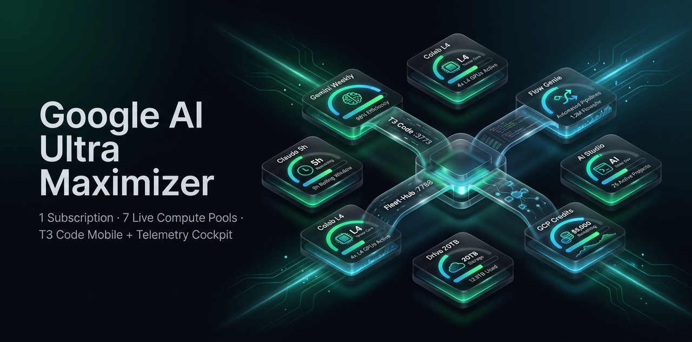
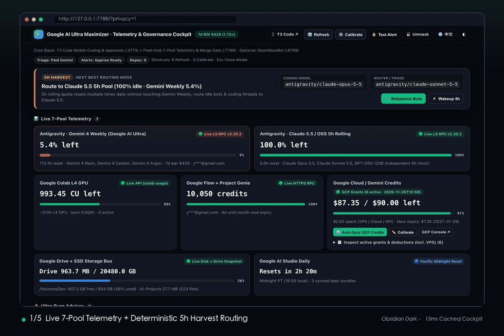
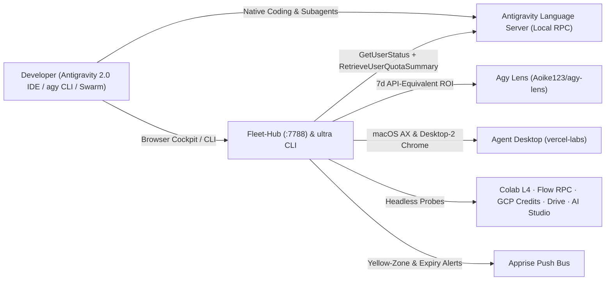

# Google AI Ultra Maximizer (`Fleet-Hub v3.0`)

**A zero-reinvented-wheels control plane and `<15ms` Spatial Observatory cockpit engineered around native Antigravity 2.0 to extract 100% of every independent quota pool inside a Google AI Ultra (or Pro) subscription.**

[English](./README.md) · [简体中文完整文档](./README.zh-CN.md) · [Zero-to-Production Setup](./docs/SETUP-FROM-SCRATCH.md) · [Architecture](./docs/ARCHITECTURE.md) · [Domain Glossary](./GLOSSARY.md)



### Live Cockpit Walkthrough (`?privacy=1`)

> **Spatial Observatory (`:7788`)**: Dual-cycle concentric SVG gauges (5h + 7d weekly) · Next Best Routing Move · 7-Pool Live Telemetry · Headless GCP Credits Breakdown · Native Antigravity Stack · Yellow-Zone Approval Gate



---

## Why This Exists

A **Google AI Ultra** subscription spans **seven separate compute budgets** with completely different reset clocks—yet most developers burn through only one of them (Antigravity's weekly Gemini pool) while leaving **hundreds of dollars of value** expiring untouched:

- **Claude Opus 5.5 / Sonnet 5.5 & GPT-OSS 120B inside Antigravity** run on an **independent 5-hour rolling pool** (plus 7d weekly bucket) that resets automatically multiple times a day without consuming your Gemini 4 weekly quota.
- **Google Flow / Project Genie credits** reset to zero at month-end.
- **Google Colab L4 GPU (2,000 CU/mo)** sits idle while local laptops overheat on TTS, transcription, or frame rendering.
- **Google Developer Program Cloud / Gemini API credits** (`$10` Pro / `$40`–`$50` Ultra / `$100` Ultra 20x depending on account tier) expire every billing cycle without rollover.
- **Google AI Studio daily web headroom** resets every midnight Pacific Time.

**Google AI Ultra Maximizer (`ultra` / `fleet`)** runs purely on **native Antigravity 2.0** (zero third-party proxy IDEs or extra bot daemons), pairing **genuine live telemetry** (zero mocked percentages, `<15ms` cached dashboard), a deterministic **Burn Advisor + Routing Verdict**, an **in-UI Credit Calibration modal**, **isolated Git worktree Yellow-Zone approvals**, and `Apprise` lock-screen alerts.

---

## How the Stack Coordinates



---

## Live 7-Pool Telemetry + Native Stack

| Pool / Layer | Live Data Source | Wheel / Runtime |
|---|---|---|
| **1. Antigravity · Gemini 4 (5h + Weekly)** | Local Language Server `GetUserStatus` + `RetrieveUserQuotaSummary` RPC (`hub_*.json`) tracking both **5-hour rolling** and **7-day weekly rolling** limits | Native **Antigravity 2.0** + `Aoike123/agy-lens` |
| **2. Antigravity · Claude 5.5 / OSS (5h + Weekly)** | Same official RPC tracking independent **5-hour rolling** + **7-day weekly rolling** limits | `skainguyen1412/antigravity-usage` (`wakeup`) |
| **3. Google Colab L4 GPU** | Live `colab usage` balance, hourly burn rate & active instance guard | `google-colab-cli` |
| **4. Google Flow + Genie** | Headless cookie cache + pure-HTTPS `nzlxg` RPC (0 browser popups) | `gflow-cli` |
| **5. Google Drive + Workspace Bus** | `statvfs` disk telemetry + `gdrive readonly quota` + SHA256 inbox sync | `gdrive` CLI |
| **6. Google AI Studio Daily** | Exact Pacific midnight countdown + synced spec bundle counter | `gemini-web-research` (`agent-desktop`) |
| **7. Cloud / Gemini Paid API** | **Headless GCP Billing Credits reader** (`ultra sync-gcp-credits`) tracking all active grants, Cloud/VPS spend & expiry | `gcp_credits_probe.py` + UI Modal |
| **Desktop GUI & Chrome Deep Research** | Native OS Accessibility Tree JSON (`@ref`) + signed-in Chrome automation | **`vercel-labs/agent-desktop`** |
| **Push Notifications** | One-line `tgram://`, `bark://`, `discord://`, `slack://`, `lark://` | **`caronc/apprise`** |

---

## 3-Minute Quick Start

```bash
git clone https://github.com/IMYin/google-ultra-maximizer.git
cd google-ultra-maximizer

# Option A: Core CLI + local dashboard only (0 external dependencies!)
./scripts/bootstrap.sh --minimal

# Option B: Full stack (installs agy-lens, agent-desktop, antigravity-usage, apprise, and Matt Pocock + Antigravity skills)
./scripts/bootstrap.sh --all --start-service
```

Then open **`http://127.0.0.1:7788`** (add `?privacy=1` to mask emails/paths before taking screenshots, or `?lang=en` / `?lang=zh` to switch language, plus the top-right theme toggle for System / Dark / Light).

See [docs/SETUP-FROM-SCRATCH.md](./docs/SETUP-FROM-SCRATCH.md) for detailed instructions on calibrating your `$50` / `$100` GCP Billing Credit pool, granting macOS Accessibility permissions for `agent-desktop`, and wiring Google Colab / Flow CLI tools.

---

## CLI Quick Reference

```bash
ultra status              # Print live 7 pools, routing verdict, Burn Advisor, native runtime & tasks
ultra status --privacy    # Redacted output safe for public screenshots & bug reports
ultra doctor              # Check native Antigravity, agy-lens, agent-desktop, and apprise
ultra wakeup              # Warm up the Antigravity 5h rolling quota window
ultra refresh-telemetry   # Force-refresh all live telemetry probes and output JSON
ultra check-update        # Check GitHub Releases & main commits for newer versions
ultra update              # Safely fast-forward (git pull --ff-only) & restart daemon
ultra sync-gcp-credits    # Headlessly read live GCP Billing Credits (incl. Cloud & API spend)
ultra gcp-login           # One-time browser sign-in if GCP Credits session needs auth
ultra service install     # Install launchd (macOS) or systemd --user (Linux) daemon
ultra daemon              # Run foreground watcher + cockpit HTTP server (127.0.0.1:7788)
```

---

## Security & Open-Source Hygiene

- Dashboard binds strictly to **`127.0.0.1`** with persistent CSRF validation and same-origin `Origin` enforcement.
- Secrets stay in `~/.config/ultra-maximizer/secrets.env` (or `~/.config/fleet-hub/secrets.env`) with `chmod 600`; the settings modal never echoes stored keys back into HTML.
- Isolated `bot/*` worktree branches automatically receive a Red-Zone `pre-push` hook preventing accidental CI triggers or production pushes.
- Automated unit test suite includes `test_open_source_hygiene_no_personal_literals` across all code, shell scripts, workflows, and docs.

```bash
python3 -m unittest discover -s tests -v
```

---

## License

[MIT](./LICENSE)
