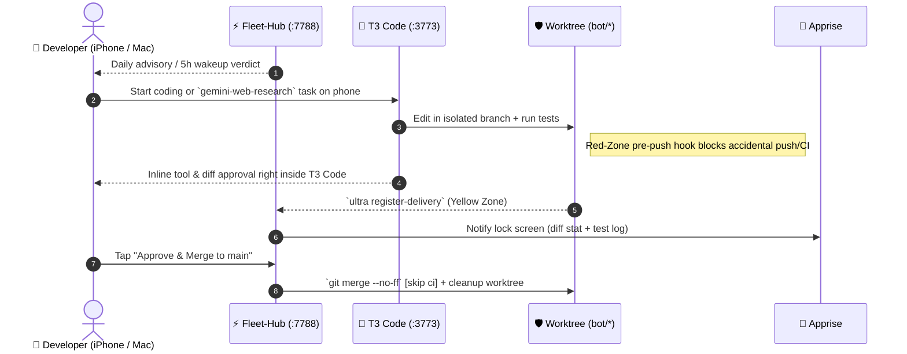
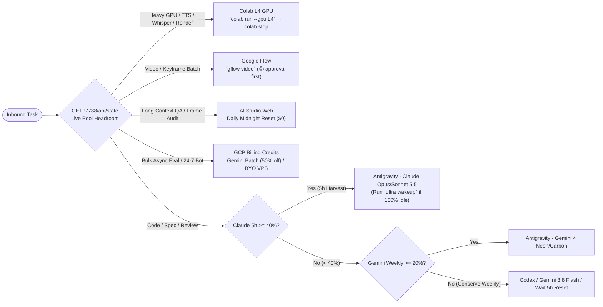

# Google AI Ultra Maximizer (`Fleet-Hub v2.2`)

**A zero-reinvented-wheels control plane, AI department pack, and precision telemetry cockpit engineered to extract 100% of every independent quota pool inside a Google AI Ultra (or Pro) subscription.**

[English](./README.md) · [简体中文完整文档](./README.zh-CN.md) · [Zero-to-Production Setup](./docs/SETUP-FROM-SCRATCH.md) · [Architecture](./docs/ARCHITECTURE.md) · [Domain Glossary](./GLOSSARY.md)

---

## Why This Exists

A **Google AI Ultra** subscription spans **seven separate compute budgets** with completely different reset clocks—yet most developers burn through only one of them (Antigravity's weekly Gemini pool) while leaving **hundreds of dollars of value** expiring untouched:

- **Claude Opus 5.5 / Sonnet 5.5 & GPT-OSS 120B inside Antigravity** run on an **independent 5-hour rolling pool** that resets automatically multiple times a day without consuming your Gemini 4 weekly quota.
- **Google Flow / Project Genie credits** reset to zero at month-end.
- **Google Colab L4 GPU (2,000 CU/mo)** sits idle while local laptops overheat on TTS, transcription, or frame rendering.
- **Google Developer Program Cloud / Gemini API credits** (`$10` Pro / `$40`–`$50` Ultra / `$100` Ultra 20x depending on account tier) expire every billing cycle without rollover.
- **Google AI Studio daily web headroom** resets every midnight Pacific Time.

**Google AI Ultra Maximizer (`ultra` / `fleet`)** pairs **genuine live telemetry** (zero mocked percentages, `<15ms` cached dashboard), a deterministic **Burn Advisor + Auto Bot Rebalancer (`ultra rebalance`)**, an **in-UI Credit Calibration modal**, **isolated Git worktree Yellow-Zone approvals**, and seamless composition with mature open-source tools instead of reinventing wheels.

---

## How the Stack Coordinates (Architecture Diagrams)

> **Lean 2-Pillar Core + 1 Optional Extension:**
> - **Core Pillar 1 — [`pingdotgg/t3code`](https://github.com/pingdotgg/t3code) (`:3773`)**: Your single mobile + browser IDE cockpit for Antigravity, Codex, and Claude Code — handles coding, Mac GUI automation (`agent-desktop` + `gemini-web-research`), live Git Worktree diffs, and inline tool approvals (`T3 Connect` QUIC relay).
> - **Core Pillar 2 — `Fleet-Hub` (`:7788`) + [`caronc/apprise`](https://github.com/caronc/apprise)**: Zero-token 7-pool telemetry (`<15ms`), headless GCP Billing Credits reader, 5h wakeup, privacy-masked screenshots, Yellow-Zone `main` merge gate, and lock-screen push alerts.
> - **Optional Add-On — [`milind-soni/OpenMausBot`](https://github.com/milind-soni/OpenMausBot) (`:8799`)**: *Not needed if T3 Code already covers your workflow!* Enable only when you want persistent background sentinels or a 24/7 containerized BYO Linux VPS (`ultra maus apply-team` installs a lean 2-bot pack with `--prune`).

### 1. System Topology (2-Pillar Core → Guardrails → 7 Compute Pools)

```mermaid
flowchart TB
    classDef entry fill:#1e293b,stroke:#38bdf8,color:#f8fafc,stroke-width:1.5px
    classDef plane fill:#0f172a,stroke:#10b981,color:#f8fafc,stroke-width:1.5px
    classDef opt fill:#1e1b2e,stroke:#94a3b8,color:#e2e8f0,stroke-dasharray:4 4
    classDef wheel fill:#18181b,stroke:#a78bfa,color:#f4f4f5,stroke-width:1.5px
    classDef pool fill:#14231b,stroke:#34d399,color:#ecfdf5,stroke-width:1.5px
    classDef warnpool fill:#271a12,stroke:#f59e0b,color:#fef3c7,stroke-width:1.5px

    subgraph ENTRY["📱 Mobile & Desktop Entry (Zero Port Forwarding)"]
        Phone["iPhone / Mobile App\n(T3 Code App · Push Alerts)"]:::entry
        Desktop["Mac Browser / Terminal\n(http://127.0.0.1:7788 · ultra · T3 Web)"]:::entry
        Push["Lock-Screen Alerts\n(Telegram · Bark · Discord · Slack)"]:::entry
    end

    subgraph PLANES["🎛️ Core Architecture (+ Optional Bot Layer)"]
        T3["Core 1: T3 Code (:3773)\nCoding · Worktree Diffs · Inline Approvals"]:::plane
        Hub["Core 2: Fleet-Hub (:7788)\n7-Pool Telemetry · Routing · main Merge Gate"]:::plane
        Maus["Optional Add-On: OpenMausBot (:8799)\n2-Bot Sentinel + BYO Linux VPS"]:::opt
    end

    subgraph WHEELS["🛡️ Guardrails & Open-Source Wheels"]
        WT["Isolated Git Worktrees\nbot/* + Red-Zone pre-push Guard"]:::wheel
        AD["Agent Desktop\nmacOS AX Tree + Chrome Deep Research"]:::wheel
        Lens["Agy Lens\nContext & 7-Day ROI Accounting"]:::wheel
        Apprise["Apprise\nMulti-Channel Push Bus"]:::wheel
        Probes["Headless Probes\nPlaywright · nzlxg RPC · colab · statvfs"]:::wheel
    end

    subgraph POOLS["⚡ 7 Independent Google AI Ultra Compute Pools"]
        P1["1. Antigravity · Gemini 4 (Weekly)"]:::warnpool
        P2["2. Antigravity · Claude 5.5 / OSS (5h Rolling)"]:::pool
        P3["3. Google Colab L4 GPU (2,000 CU/mo)"]:::pool
        P4["4. Google Flow / Genie (Month-End Expiry)"]:::warnpool
        P5["5. Google Drive + SSD Bus (20TB)"]:::pool
        P6["6. Google AI Studio Web (Daily Reset)"]:::pool
        P7["7. GCP Billing Credits (BYO VPS + Batch API)"]:::pool
    end

    Phone <-->|"T3 Connect QUIC Relay"| T3
    Desktop --> T3 & Hub
    T3 -->|"ACP / Subprocess"| P1 & P2
    T3 -->|"Worktree Coding & Diffs"| WT
    T3 -->|"macOS AX & Web Research"| AD
    Hub -->|"Live Telemetry"| Probes --> P1 & P2 & P3 & P4 & P5 & P6 & P7
    Hub -->|"GetUserStatus + ROI"| Lens
    Hub -->|"Apprise CLI"| Apprise --> Push
    Maus -.->|"GET :7788/api/state"| Hub
    Hub -.->|"ultra rebalance"| Maus
    Maus -.->|"Included 5h Pool"| P2
    Maus -.->|"SSH / Docker (GCP Funded)"| P7
```



### 2. End-to-End Core Loop (Mobile `T3 Code` → Safe `main` Merge)



### 3. Smart Quota Routing Decision Flow



---

## Quota & GCP Credit Billing Truth Table (Which Pool Pays?)

| Tool / Provider Selection | Quota Pool Consumed | Spends GCP Credits (`$10/$50/$90+`)? |
|---|---|---|
| **T3 Code → Antigravity** (Gemini 4 / Claude 5.5) | Included Pool #1 (Weekly) or #2 (Claude 5h Rolling) | **No ($0 GCP credits)** |
| **T3 Code → Codex / Claude** | Your ChatGPT Plus / Claude subscription | **No ($0 GCP credits)** |
| **OpenMausBot *(Optional)* → Antigravity** | Included Pool #2 (Claude 5.5 5h Rolling) | **No ($0 GCP credits)** |
| **OpenMausBot / Tools → Google AI Studio API Key** | GCP Billing / Gemini Paid API | **Yes** (only if bound to a billed project) |
| **GCP Cloud VM (VPS), Cloud Storage, Gemini Batch API** | Pool #7 (`paid_gemini_api` GCP Credits) | **Yes** (tracked live via `ultra sync-gcp-credits`) |

---

## Architecture Maturity Assessment

| Layer | Maturity | What Works Today | Known Boundary / Role |
|---|---|---|---|
| **Mobile & Web IDE (`T3 Code :3773`)** | **Production-Ready (Core)** | `T3 Connect` QUIC relay, coding, Git worktrees, live diffs, inline tool approvals, Antigravity + Codex + Claude, `ultra t3-pair` | Primary coding & approval cockpit on mobile and desktop |
| **Control Plane (`Fleet-Hub :7788`)** | **Production-Ready (Core)** | `<15ms` cached 7-pool telemetry, headless GCP credit sync, Burn Advisor, Yellow-Zone merge gate, `Apprise` push, 14 tests | Loopback `127.0.0.1` governance cockpit (`--privacy`, ZH/EN, dark/light) |
| **Quota Probes (`agy` / `colab` / `flow` / `gcp`)** | **Production-Ready (Session-Dependent)** | Direct LanguageServer RPC (`hub_*.json`), headless `nzlxg` wire probe, headless Playwright GCP grant breakdown | Flow/Colab/GCP rely on signed-in browser/CLI sessions; `ultra gcp-login` refreshes GCP auth |
| **Optional Bot Dept (`OpenMausBot :8799`)** | **Production-Ready (Optional)** | Antigravity ACP, 2-bot sentinel pack (`--prune`), inline 👍 cards, built-in `agent-browser`, BYO Linux VPS | Optional add-on — turn off anytime if T3 Code already covers your flow |
| **Cross-Device `.ai/` Sync & Merge Gate** | **Beta / Semi-Auto** | SHA256 inbox parsing, `.zip` debounce + CRC verification, bidirectional `_APPROVAL_CENTER.md`, Red-Zone `pre-push` hook | Intentionally keeps final `main` merges gated behind human approval |

---

## Live 7-Pool Telemetry + Composable Open-Source Stack

| Pool / Layer | Live Data Source | Open-Source Wheel |
|---|---|---|
| **1. Antigravity · Gemini Weekly** | Local Language Server `GetUserStatus` loopback RPC (`hub_*.json`) | `Aoike123/agy-lens` (`agy-lens --json` ROI) |
| **2. Antigravity · Claude / OSS 5h Rolling** | Same official RPC split by reset window / model family | `skainguyen1412/antigravity-usage` (`wakeup`) |
| **3. Google Colab L4 GPU** | Live `colab usage` balance, hourly burn rate & active instance guard | `google-colab-cli` |
| **4. Google Flow + Genie** | Headless cookie cache + pure-HTTPS `nzlxg` RPC (0 browser popups) | `gflow-cli` |
| **5. Google Drive + Workspace Bus** | `statvfs` disk telemetry + `gdrive readonly quota` + SHA256 inbox sync | `gdrive` CLI |
| **6. Google AI Studio Daily** | Exact Pacific midnight countdown + synced spec bundle counter | `gemini-web-research` (`agent-desktop`) |
| **7. Cloud / Gemini Paid API** | **Headless GCP Billing Credits reader** (`ultra sync-gcp-credits`) tracking all active grants, VPS/cloud spend & expiry | `gcp_credits_probe.py` + UI Modal |
| **Core Mobile Coding, Diffs & Approvals** | Web / iOS / Android + `T3 Connect` zero-port-forwarding relay + single-click `ultra t3-pair` | **`pingdotgg/t3code`** (`:3773`) |
| **Optional Routines & BYO VPS** | Optional 2-bot sentinel pack (`Ultra Chief` + `VPS Cloud Scout`) + BYO Linux VPS via SSH/Docker | **`milind-soni/OpenMausBot`** (`:8799`) |
| **Desktop GUI & Chrome Deep Research** | Native OS Accessibility Tree JSON (`@ref`) + signed-in Chrome automation | **`vercel-labs/agent-desktop`** |
| **Push Notifications** | One-line `tgram://`, `bark://`, `discord://`, `slack://`, `lark://` | **`caronc/apprise`** |

---

## 3-Minute Quick Start

```bash
git clone https://github.com/IMYin/google-ultra-maximizer.git
cd google-ultra-maximizer

# Option A: Core CLI + local dashboard only (0 external dependencies!)
./scripts/bootstrap.sh --minimal

# Option B: Full stack (installs t3code, openmausbot, agy-lens, agent-desktop, apprise, and Matt Pocock engineering skills)
./scripts/bootstrap.sh --all --start-service
```

Then open **`http://127.0.0.1:7788`** (add `?privacy=1` to mask emails/paths before taking screenshots, or `?lang=en` / `?lang=zh` to switch language, plus the top-right `◐` button for Obsidian Dark / Editorial Light theme).

See [docs/SETUP-FROM-SCRATCH.md](./docs/SETUP-FROM-SCRATCH.md) for detailed instructions on connecting your phone via `T3 Connect` & `OpenMausBot`, calibrating your exact `$50` / `$100` GCP Billing Credit pool, granting macOS Accessibility permissions for `agent-desktop`, and wiring Google Colab / Flow CLI tools.

---

## CLI Quick Reference

```bash
ultra status              # Print live 7 pools, routing verdict, Burn Advisor, wheel health & tasks
ultra status --privacy    # Redacted output safe for public screenshots & bug reports
ultra doctor              # Check t3code, optional openmausbot, agy-lens, agent-desktop, and apprise
ultra t3-pair             # Mint a fresh one-time T3 Code pairing URL for a new browser tab
ultra maus install        # [Optional] Launch OpenMausBot (unattended routines / BYO VPS)
ultra maus apply-team     # [Optional] Sync & --prune the lean 2-bot sentinel pack (`Ultra Chief` + `VPS Cloud Scout`)
ultra rebalance           # Route idle Antigravity bots onto optimal pool (e.g. Claude 5.5 5h)
ultra wakeup              # Warm up the Antigravity 5h rolling quota window
ultra refresh-telemetry   # Force-refresh all live telemetry probes and output JSON
ultra sync-gcp-credits    # Headlessly read live GCP Billing Credits (incl. VPS & cloud spend)
ultra gcp-login           # One-time browser sign-in if GCP Credits session needs auth
ultra service install     # Install launchd (macOS) or systemd --user (Linux) daemon
ultra fix-t3-service      # Fix macOS launchd EX_CONFIG (78) when T3CODE_HOME is on an external SSD
ultra daemon              # Run foreground watcher + cockpit HTTP server (127.0.0.1:7788)
```

---

## Security & Open-Source Hygiene

- Dashboard binds strictly to **`127.0.0.1`** with persistent CSRF validation and same-origin `Origin` enforcement.
- Secrets stay in `~/.config/ultra-maximizer/secrets.env` (or `~/.config/fleet-hub/secrets.env`) with `chmod 600`; the settings modal never echoes stored keys back into HTML.
- Isolated `bot/*` worktree branches automatically receive a Red-Zone `pre-push` hook preventing accidental CI triggers or production pushes.
- Automated unit test suite includes `test_open_source_hygiene_no_personal_literals` across all code, shell scripts, workflows, and docs.

```bash
python3 -m unittest discover -s tests -v
```

---

## License

[MIT](./LICENSE)
