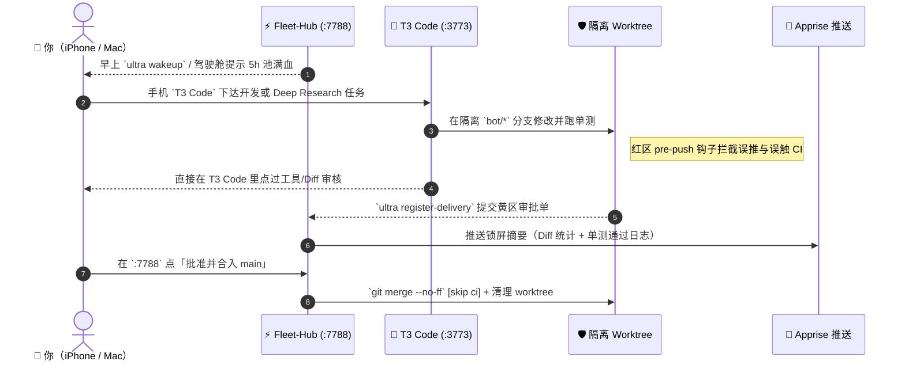
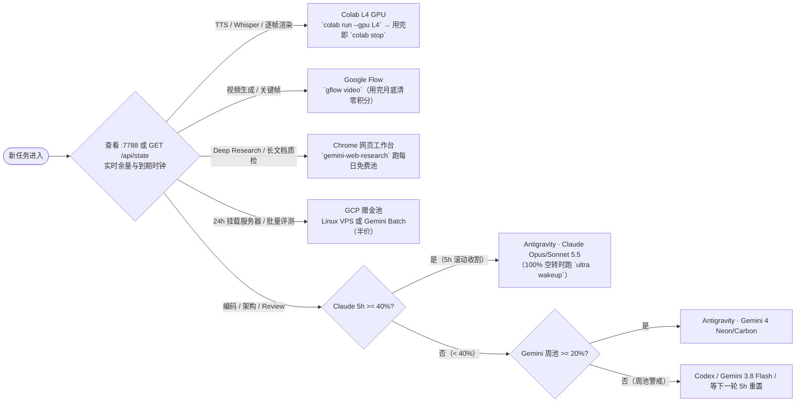

# Google AI Ultra Maximizer (`Fleet-Hub v2.3`)

**一套零冗余轮子、与 `T3 Code` 双核协同、支持 `<15ms` 极速 7 池遥测与无头 GCP 赠金账本读取的开源控制底座，帮你把 Google AI Ultra（或 Pro）套餐里的每一块独立算力额度真正「吃干抹净」。**

[English README](./README.md) · [从零搭建完整教程](./docs/SETUP-FROM-SCRATCH.md) · [系统架构](./docs/ARCHITECTURE.md) · [领域词汇表 GLOSSARY](./GLOSSARY.md) · [Matt Pocock 工程技能手册](./docs/MATTPOCOCK-SKILLS-PLAYBOOK.md)


### 实机驾驶舱动态演示（已开启 `?privacy=1` 隐私脱敏）

> 10 秒看懂核心能力：**7 池实时遥测与 5h 智能路由** → **无头读取 GCP 赠金扣费明细** → **T3 Code 一键配对与开源栈** → **\$10 / \$50 / \$100 快速校准弹窗** → **极夜暗色 / 暖白双主题切换**


---

## 为什么做这个项目？

很多开发者订阅了 **Google AI Ultra**，却往往只用掉 **20%–30%** 的真实价值：
1. **周池见底，5h 池全程 100% 空转**：Antigravity 里的 **Gemini 4** 按周计额，但同一个订阅里的 **Claude Opus 5.5 / Sonnet 5.5 / GPT-OSS 120B** 是**每 5 小时自动重置 100% 的独立滚动池**，切过去写代码、做 Review 完全不扣 Gemini 周池。
2. **月底清零的隐形资源全忘了烧**：每月重设的 **Google Flow / Genie 视频积分**、**2,000 CU 的 Colab L4 显卡**、以及 Google Developer Program 每月赠送的 **\$10 / \$40 / \$50 / \$100 Cloud API 赠金**（各账号活动/档位不同）过期即作废。
3. **极简双核心 ＋ 1 个可选扩展（绝不重复造轮子）**：
   - **核心 1 · 手机/桌面主力编程与审批台（`pingdotgg/t3code :3773`）**：一条 App 直接覆盖远程改代码、隔离 Worktree Diff、Mac 终端/GUI（`agent-desktop` + `gemini-web-research`）以及工具执行审核，`T3 Connect` 穿透外网不掉线（`ultra t3-pair` 可随时给新浏览器签一次性免密链接）。
   - **核心 2 · 算力大脑与合入闸门（`Fleet-Hub :7788` + `caronc/apprise`）**：7 池真实探针（`<15ms` 极速驾驶舱）+ 无头读取 GCP 赠金账本 + `ultra wakeup` + 黄区 `main` 合入确认 + 锁屏推送。
   - **可选扩展 · 后台 Bot / BYO VPS（`milind-soni/OpenMausBot :8799`）**：*如果 `T3 Code` 已经满足你的全部需求，完全可以不用开它！* 仅在你需要无人值守定时巡检、后台长耗时网页调研或挂载 **GCP 赠金购买的 Linux VPS** 时按需开启（`ultra maus apply-team` 已精简为 `--prune` 模式的 2 位哨兵 Bot + 1 频道）。

> **明确区分：哪款工具扣哪个池子？会不会消耗你的 GCP 赠金？**
> - **`T3 Code` 选 Antigravity（Gemini 4 / Claude 5.5）** → 扣订阅自带的周池或 **5 小时滚动池**，**0 消耗 GCP 赠金**。
> - **`T3 Code` 选 Codex / Claude** → 扣你自己的 ChatGPT Plus / Claude 订阅，**0 消耗 GCP 赠金**。
> - **`OpenMausBot`（默认 `antigravity/claude-sonnet-5-5`）** → 同样扣订阅自带的 **5 小时滚动池**，**完全不花 Google Cloud 赠金**（除非你自己额外粘了 AI Studio 的付费 API Key）。
> - **真正消耗 GCP 赠金（第 7 池）的只有两项**：你买的那台 **GCP Linux VPS / 云资源**，以及可选的 `GEMINI_PAID_API_KEY`（可用 `ultra sync-gcp-credits` 随时核对）。

---

## 整套架构如何配合（精简双核全景图）

### 1. 系统全局拓扑（极简双核心 + 可选 Bot → 护栏轮子 → 7 大算力池）

```mermaid
flowchart TB
    classDef entry fill:#1e293b,stroke:#38bdf8,color:#f8fafc,stroke-width:1.5px
    classDef plane fill:#0f172a,stroke:#10b981,color:#f8fafc,stroke-width:1.5px
    classDef opt fill:#1e1b2e,stroke:#94a3b8,color:#e2e8f0,stroke-dasharray:4 4
    classDef wheel fill:#18181b,stroke:#a78bfa,color:#f4f4f5,stroke-width:1.5px
    classDef pool fill:#14231b,stroke:#34d399,color:#ecfdf5,stroke-width:1.5px
    classDef warnpool fill:#271a12,stroke:#f59e0b,color:#fef3c7,stroke-width:1.5px

    subgraph ENTRY["📱 移动端与桌面入口（零公网端口暴露）"]
        Phone["iPhone / 手机客户端\n(T3 Code App · 锁屏推送)"]:::entry
        Desktop["电脑浏览器 / 终端 CLI\n(http://127.0.0.1:7788 · ultra · T3 Web)"]:::entry
        Push["锁屏强提醒\n(Telegram · Bark · Discord · 飞书)"]:::entry
    end

    subgraph PLANES["🎛️ 核心双轮 + 可选扩展"]
        T3["核心 1：T3 Code (:3773)\n编程 · Worktree Diff · 工具审核"]:::plane
        Hub["核心 2：Fleet-Hub (:7788)\n7 池实测遥测 · 路由建议 · main 合入闸门"]:::plane
        Maus["可选扩展：OpenMausBot (:8799)\n2-Bot 哨兵巡检 · BYO Linux VPS"]:::opt
    end

    subgraph WHEELS["🛡️ 执行护栏与开源轮子底座"]
        WT["隔离 Git Worktree\nbot/* 分支 + 红区 pre-push 禁推锁"]:::wheel
        AD["Agent Desktop\n系统 AX 树 + Chrome 深度研究"]:::wheel
        Lens["Agy Lens\n上下文透视 & 近 7 天回本倍数"]:::wheel
        Apprise["Apprise\n多渠道异步推送总线"]:::wheel
        Probes["无头探针引擎\nPlaywright · nzlxg RPC · colab · statvfs"]:::wheel
    end

    subgraph POOLS["⚡ Google AI Ultra 7 大独立算力池"]
        P1["1. Antigravity · Gemini 4 (周池)"]:::warnpool
        P2["2. Antigravity · Claude 5.5 / OSS (5h 滚动池)"]:::pool
        P3["3. Google Colab L4 GPU (每月 2,000 CU)"]:::pool
        P4["4. Google Flow / Genie (月底清零)"]:::warnpool
        P5["5. Google Drive + 外置 SSD (20TB)"]:::pool
        P6["6. Google AI Studio 网页池 (每日清零)"]:::pool
        P7["7. GCP 赠金账本 (Linux VPS + Batch API)"]:::pool
    end

    Phone <-->|"T3 Connect QUIC 中继"| T3
    Desktop --> T3 & Hub
    T3 -->|"ACP / CLI"| P1 & P2
    T3 -->|"隔离代码施工"| WT
    T3 -->|"桌面/Chrome 自动化"| AD
    Hub -->|"实时无感探测"| Probes --> P1 & P2 & P3 & P4 & P5 & P6 & P7
    Hub -->|"GetUserStatus + ROI"| Lens
    Hub -->|"Apprise CLI"| Apprise --> Push
    Maus -.->|"GET :7788/api/state"| Hub
    Hub -.->|"ultra rebalance"| Maus
    Maus -.->|"订阅 5h 池（$0 赠金）"| P2
    Maus -.->|"SSH / Docker（花 GCP 赠金）"| P7
```



### 2. 端到端极简主流程（手机 `T3 Code` 发指令到安全合入 `main`）



### 3. 跨 7 池智能路由决策流（让每份算力都不空转过期）



---

## 当前架构成熟度评估

| 模块层级 | 当前成熟度 | 已验证可稳定运行的能力 | 边界与角色定位 |
|---|---|---|---|
| **核心 1 · 移动编程面（`T3 Code :3773`）** | **生产可用（主力）** | `T3 Connect` QUIC 无端口穿透中继、写代码、看 Worktree Diff、工具与执行审核、一键签浏览器配对码（`ultra t3-pair`） | 手机端与桌面端唯一的日常交互与编码主入口 |
| **核心 2 · 治理控制面（`Fleet-Hub :7788`）** | **生产可用（主力）** | `<15ms` 按隐私态分桶缓存、CSRF/同源校验、SQLite WAL、无头读取 GCP 赠金账本、14 项单测与开源零隐私门禁 | 专注跨池算力遥测、截图脱敏与 `main` 合入闸门 |
| **7 池实时探针（`agy/colab/flow/gcp`）** | **生产可用（依赖会话）** | 直连本机 LanguageServer RPC、纯 HTTPS `nzlxg` 无弹窗探针、无头 Playwright 读取 GCP 赠金扣费明细 | Flow/Colab/GCP 依赖各自登录会话；过期跑一次 `ultra gcp-login` |
| **可选扩展 · 哨兵 Bot（`OpenMausBot :8799`）** | **生产可用（可选）** | 原生 Antigravity ACP、精简 2-Bot 哨兵包（`--prune`）、内联 👍 审批、BYO Linux VPS | 纯可选扩展——习惯单用 `T3 Code` 时随时关闭即可 |
| **跨端 `.ai/` 同步与黄区合入** | **Beta / 半自动** | SHA256 增量解析、`.zip` 防抖与 CRC 校验、双向 `_APPROVAL_CENTER.md`、红区 `pre-push` 防误推 | 默认坚持黄区人工拍板后再合入 `main` |

---

## 7 大独立算力池实测遥测（零虚标）

| 算力池 | 真实数据源 | 重置周期 | 怎么用最划算 |
|---|---|---|---|
| **1. Antigravity · Gemini 4 双周期池** | 本机 Language Server `GetUserStatus` + `RetrieveUserQuotaSummary` 环回直连 | **5h 滚动 + 1周滚动** | 留给重度架构设计与长链推理，兼顾 5h 与周限额 |
| **2. Antigravity · Claude 5.5 / OSS 双周期池** | 同上，直读官方 `5h` 与 `weekly` 双桶分池限额 | **5h 滚动 + 1周滚动** | **点击 `⚡ 唤醒 5h 池` 并在 T3 Code 切换到推荐池（启用可选 OpenMausBot 时会显示 `⚖️ Bot 智能切池`），同步盯紧 5h 与周额度** |
| **3. Google Colab L4 GPU** | `colab usage` 实时余额与按小时计费报警 | 每月 2,000 CU | 语音克隆 (F5-TTS)、Whisper 对齐、逐帧渲染全卸载云端 L4 |
| **4. Google Flow + Project Genie** | 无头浏览器指纹缓存 + 纯 HTTPS `nzlxg` RPC | 月底清零 | 参谋实时计算「距月底剩余天数 × 每日需烧积分」，绝不浪费 |
| **5. Google Drive + 工作区存储** | `statvfs` + `gdrive readonly quota` | 持续 | 跨端只传结构化需求与校验后素材包 |
| **6. Google AI Studio 网页池** | 精确太平洋午夜重置倒计时 | 每日重置 | 免费长文本考据与视频抽帧质检 |
| **7. Cloud / Gemini 赠金池** | **一键无头读取 GCP Billing Credits 账单表**（汇总每笔生效赠金、VPS/云服务已扣费用与到期日）+ 本地 API `usageMetadata` | 跨月/到期精准核算 |

---

## 3 分钟从零部署（任何开发者克隆即用）

```bash
git clone https://github.com/IMYin/google-ultra-maximizer.git
cd google-ultra-maximizer

# 方式 A：只装核心控制面与本地驾驶舱（零外部依赖，仅需 Python >= 3.11）
./scripts/bootstrap.sh --minimal

# 方式 B：完整装机（自动装配 t3code + openmausbot + agy-lens + agent-desktop + apprise + Matt Pocock 工程 Skills）
./scripts/bootstrap.sh --all --start-service
```

启动后浏览器打开：**`http://127.0.0.1:7788`**
- 驾驶舱提供 **极夜暗色 / 暖白编辑双主题 (`◐`)**、**`?privacy=1` 一键脱敏**、**`?lang=en` / `?lang=zh` 双语切换**，以及 **`R` 刷新 / `S` 打开校准** 快捷键。
- 常用命令速查：
  - `ultra rebalance`（仅在启用可选 OpenMausBot 且有 Bot 时页面会显示 **⚖️ Bot 智能切池**）：自动把闲置 Antigravity Bot 从紧缺周池切到 5h Claude 5.5 池；单用 T3 Code 时直接点击推荐模型芯片即可复制切用。
  - `ultra wakeup`（或页面点 **⚡ 唤醒 5h 池**）：主动开启 5h 滚动时钟。
  - `ultra sync-gcp-credits`：无头读取 GCP 生效赠金与 VPS/API 扣费明细。

---

## 常见核心场景避坑指南

> 更完整的每一步操作说明见 **[从零搭建完整手册 docs/SETUP-FROM-SCRATCH.md](./docs/SETUP-FROM-SCRATCH.md)**。

1. **怎么知道我买的 VPS、云服务和 API 一共扣了多少赠金？**
   Google Cloud Billing API 不对个人账户开放赠金余额接口，所以内置了无头账单读数探针：在驾驶舱卡片点击 **🔄 自动读取 GCP 赠金**（或终端跑 `ultra sync-gcp-credits`；首次如未登录跑一次 `ultra gcp-login`），系统会在无感后台直接拉取你账户下所有 `Available` 生效赠金的**剩余美元 / 原始总额 / 已扣总额 / 各自到期日**并展示明细表。
2. **macOS 外置硬盘跑 `launchd` 服务报 `EX_CONFIG (78)` 怎么办？**
   macOS 会拦截 `launchd` 直接把日志文件写在外置移动硬盘。本项目内置 `ultra service install`（自带守护服务）与 `ultra fix-t3-service`（一键修复 `t3code` 后台服务），会自动把日志放到 `~/.config/...` 下而把重体积数据留在你的外置 SSD 上。
3. **手机连不上 `t3code` 或 `Antigravity` 显示 `Turned off` 怎么办？**
   - 手机端新环境在 **Settings → Environments → 右上角 `+`** 里；务必和电脑用同一个 Google 登录方式（不要选 Apple 隐藏邮箱登录）。
   - `Antigravity` 在 `t3code` 服务端默认关闭且手机端不能直接开开关，需在 `userdata/settings.json` 写入 `providerInstances.antigravity.enabled = true`。
4. **`agent-desktop` 为什么电脑终端显示绿灯，网页面板里曾看到 `denied`？**
   macOS 辅助功能（Accessibility）权限按**启动它的宿主 App**（如 Terminal / Antigravity / OpenMausBot.app）分别授权；后台无头守护进程下检测不到宿主 UI 权限属于正常系统机制，实际能力以启动 Agent 的宿主为准（终端运行 `agent-desktop status` 校验）。

---

## 开源许可与测试

```bash
python3 -m unittest discover -s tests -v
bash -n scripts/bootstrap.sh
```

[MIT License](./LICENSE)
