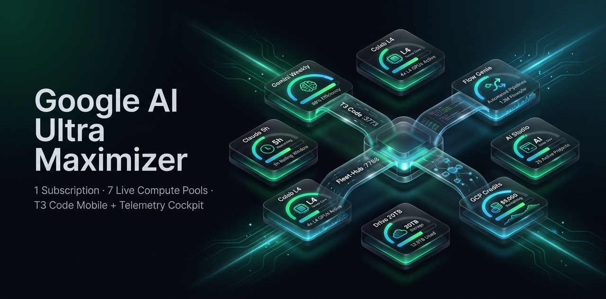
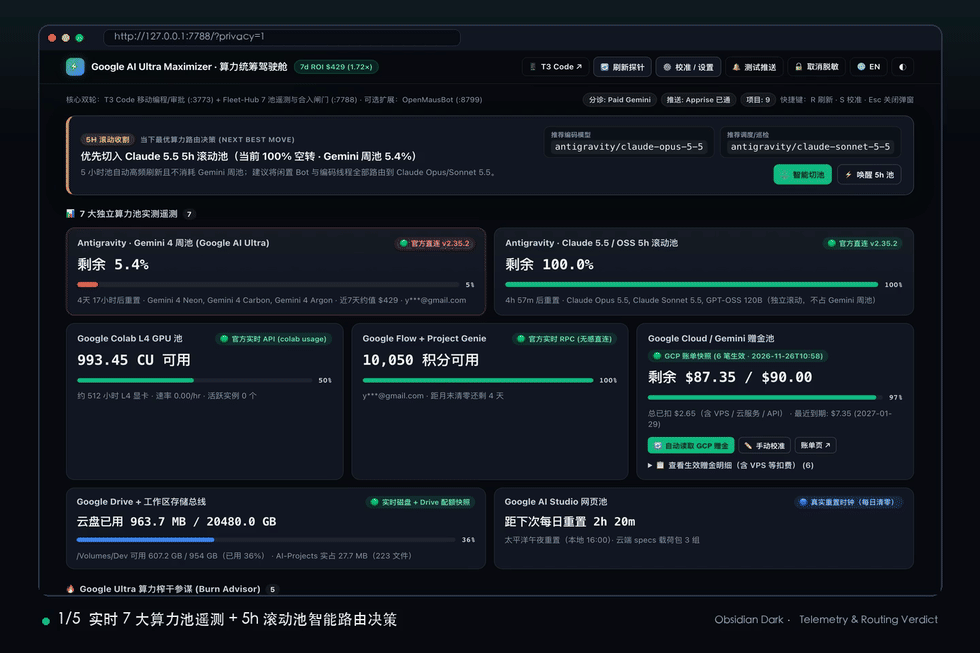
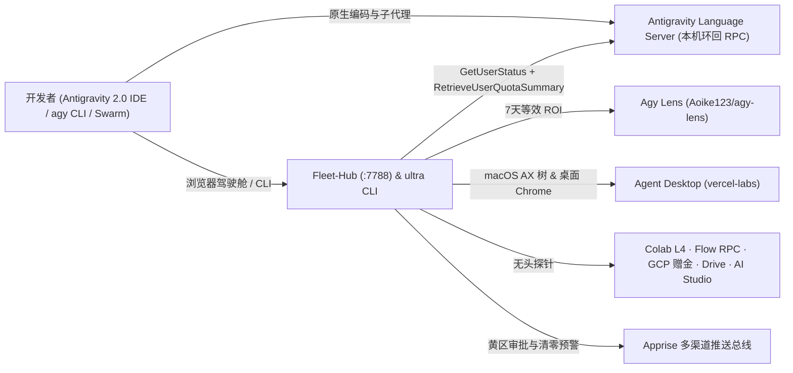

# Google AI Ultra Maximizer (`Fleet-Hub v3.0`)

**一套纯原生态接入 Antigravity 2.0、支持 `<15ms` 极速 7 池遥测、同心双环仪表盘与无头 GCP 赠金账本读取的开源算力控制底座，帮你把 Google AI Ultra（或 Pro）套餐里的每一块独立算力额度真正「吃干抹净」。**

[English README](./README.md) · [从零搭建完整教程](./docs/SETUP-FROM-SCRATCH.md) · [系统架构](./docs/ARCHITECTURE.md) · [领域词汇表 GLOSSARY](./GLOSSARY.md) · [Matt Pocock 工程技能手册](./docs/MATTPOCOCK-SKILLS-PLAYBOOK.md)



### 实机驾驶舱动态演示（已开启 `?privacy=1` 隐私脱敏）

> Spatial Observatory 空间观测台：**7 池实时遥测与同心双环 5h/7d 仪表** → **无头读取 GCP 赠金扣费明细** → **原生 Antigravity 2.0 底座** → **\$10 / \$50 / \$100 快速校准弹窗** → **极夜暗色 / 瓷白双主题自动适配**



---

## 为什么做这个项目？

很多开发者订阅了 **Google AI Ultra**，却往往只用掉 **20%–30%** 的真实价值：
1. **周池见底，5h 池全程 100% 空转**：Antigravity 里的 **Gemini 4** 兼顾 5h 与 1 周滚动限额，而同一个订阅里的 **Claude Opus 5.5 / Sonnet 5.5 / GPT-OSS 120B** 拥有**独立的每 5 小时自动重置滚动池**，切过去写代码、做 Review 完全不扣 Gemini 周池。
2. **月底清零的隐形资源全忘了烧**：每月重设的 **Google Flow / Genie 视频积分**、**2,000 CU 的 Colab L4 显卡**、以及 Google Developer Program 每月赠送的 **\$10 / \$40 / \$50 / \$100 Cloud API 赠金**（各账号活动/档位不同）过期即作废。
3. **纯原生态 Antigravity 2.0 架构（零第三方代理、零冗余轮子）**：
   - **主执行面 · 原生 Antigravity 2.0 (`IDE` / `agy` CLI / Swarm)**：直接通过官方 IDE、终端 CLI 与子代理/Swarm 协同写代码、跑调研、切模型。
   - **算力大脑与合入闸门 · `Fleet-Hub (:7788)` + `caronc/apprise`**：7 池真实探针（`<15ms` 极速驾驶舱）+ 无头读取 GCP 赠金账本 + `ultra wakeup` + 黄区 `main` 合入确认 + 锁屏推送。

---

## 整套架构如何配合



---

## 7 大独立算力池实测遥测（零虚标）

| 算力池 | 真实数据源 | 重置周期 | 怎么用最划算 |
|---|---|---|---|
| **1. Antigravity · Gemini 4 双周期池** | 本机 Language Server `GetUserStatus` + `RetrieveUserQuotaSummary` 环回直连 | **5h 滚动 + 1周滚动** | 留给重度架构设计与长链推理，兼顾 5h 与周限额 |
| **2. Antigravity · Claude 5.5 / OSS 双周期池** | 同上，直读官方 `5h` 与 `weekly` 双桶分池限额 | **5h 滚动 + 1周滚动** | **5h 空转时点 `唤醒 5h 池`，在 Antigravity 切换到推荐池，同步盯紧 5h 与周额度** |
| **3. Google Colab L4 GPU** | `colab usage` 实时余额与按小时计费报警 | 每月 2,000 CU | 语音克隆 (F5-TTS)、Whisper 对齐、逐帧渲染全卸载云端 L4 |
| **4. Google Flow + Project Genie** | 无头浏览器指纹缓存 + 纯 HTTPS `nzlxg` RPC | 月底清零 | 参谋实时计算「距月底剩余天数 × 每日需烧积分」，绝不浪费 |
| **5. Google Drive + 工作区存储** | `statvfs` + `gdrive readonly quota` | 持续 | 跨端只传结构化需求与校验后素材包 |
| **6. Google AI Studio 网页池** | 精确太平洋午夜重置倒计时 | 每日重置 | 免费长文本考据与视频抽帧质检 |
| **7. Cloud / Gemini 赠金池** | **一键无头读取 GCP Billing Credits 账单表**（汇总每笔生效赠金、云服务已扣费用与到期日）+ 本地 API `usageMetadata` | 跨月/到期精准核算 |

---

## 3 分钟从零部署（任何开发者克隆即用）

```bash
git clone https://github.com/IMYin/google-ultra-maximizer.git
cd google-ultra-maximizer

# 方式 A：只装核心控制面与本地驾驶舱（零外部依赖，仅需 Python >= 3.11）
./scripts/bootstrap.sh --minimal

# 方式 B：完整装机（自动装配 agy-lens + agent-desktop + antigravity-usage + apprise + Matt Pocock & Antigravity 技能）
./scripts/bootstrap.sh --all --start-service
```

启动后浏览器打开：**`http://127.0.0.1:7788`**
- 驾驶舱提供 **跟随系统 / 极夜暗色 / 瓷白双主题**、**`?privacy=1` 一键脱敏**、**`?lang=en` / `?lang=zh` 双语切换**，以及 **`R` 刷新 / `S` 打开校准 / `Esc` 关闭弹窗** 快捷键。
- 常用命令速查：
  - `ultra status`：查看 7 池余量、路由建议、参谋提示与任务状态。
  - `ultra doctor`：检查原生 Antigravity、Agy Lens、Agent Desktop 与 Apprise 就绪情况。
  - `ultra wakeup`（或页面点 **唤醒 5h 池**）：主动开启 5h 滚动时钟。
  - `ultra check-update` / `ultra update`：检查 GitHub Releases 与 `main` 分支更新，或安全快进更新并重启。
  - `ultra sync-gcp-credits`：无头读取 GCP 生效赠金与云服务/API 扣费明细。

---

## 常见核心场景避坑指南

> 更完整的每一步操作说明见 **[从零搭建完整手册 docs/SETUP-FROM-SCRATCH.md](./docs/SETUP-FROM-SCRATCH.md)**。

1. **怎么知道我买的云服务和 API 一共扣了多少赠金？**
   Google Cloud Billing API 不对个人账户开放赠金余额接口，所以内置了无头账单读数探针：在驾驶舱卡片点击 **同步 GCP 赠金**（或终端跑 `ultra sync-gcp-credits`；首次如未登录跑一次 `ultra gcp-login`），系统会在无感后台直接拉取你账户下所有 `Available` 生效赠金的**剩余美元 / 原始总额 / 已扣总额 / 各自到期日**并展示明细表。
2. **`agent-desktop` 为什么电脑终端显示绿灯，后台守护进程偶现宿主权限提示？**
   macOS 辅助功能（Accessibility）权限按**启动它的宿主 App**（如 Terminal / Antigravity）分别授权；后台无头守护进程下检测不到宿主 UI 权限属于正常系统机制，实际能力以启动 Agent 的宿主为准（终端运行 `agent-desktop status` 校验）。

---

## 开源许可与测试

```bash
python3 -m unittest discover -s tests -v
bash -n scripts/bootstrap.sh
```

[MIT License](./LICENSE)
