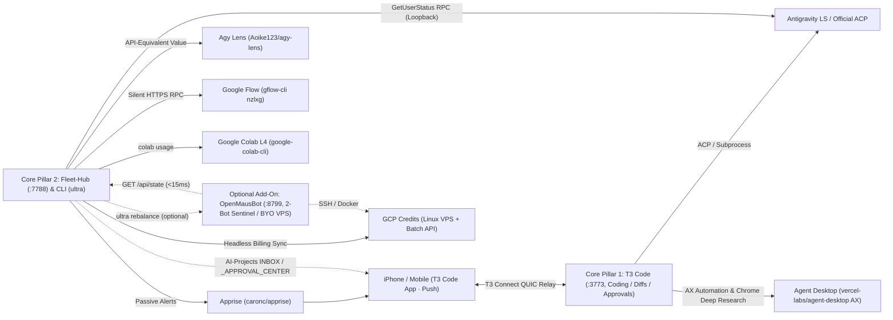

# Architecture (`Google AI Ultra Maximizer`)

Designed around Matt Pocock's **Deep Modules** (`codebase-design`) and **Software Factory** (`software-factory`) principles: keep custom Python small and deep, delegate heavy capabilities to proven open-source **Wheels**, and verify every seam through public interfaces.

## System Topology (Lean 2-Pillar Core + Optional Bot Extension)

## Role of the `:7788` Web Cockpit vs `T3 Code` vs Optional `OpenMausBot`

Because **`T3 Code (:3773)`** natively handles mobile & desktop coding, Mac terminal/GUI execution, live Git diffs, and inline tool approvals, **no mandatory multi-bot daemon is required** for day-to-day solo engineering:
1. **`T3 Code (:3773)` (Primary Execution & Approval Surface)**: Heavy multi-file work, Worktree diffs, Codex/Antigravity threads, and approval prompts. (Mint fresh browser tokens anytime via `ultra t3-pair` or `🔑 Auto-Pair ↗`.)
2. **`Fleet-Hub (:7788)` (Cross-Pool Telemetry & Governance Plane)**:
   - Aggregates live balances across all 7 Google AI Ultra pools (`<15ms` cached per privacy mode, pre-warmed by `daemon.py`).
   - Runs zero-token `compute_routing_verdict()` so you immediately see when `Claude 5.5 (5h)` is 100% idle while `Gemini Weekly` is low.
   - Hosts operational tools missing from T3 Code: `ultra sync-gcp-credits` (Playwright grant table probe), `ultra wakeup`, `secrets.env` calibration, Privacy Mask screenshots, `Apprise` lock-screen alerts, and Yellow-Zone `--no-ff` merges to `main`.
3. **`OpenMausBot (:8799)` (Strictly Optional Add-On)**: Enable only when you want unattended scheduled sentinels (`prune: true`, slim 2-bot team: `Ultra Chief` + `VPS Cloud Scout`) or a 24/7 containerized BYO Linux VPS. Runs on your **included Antigravity 5h pool** (`$0` GCP credits) unless switched to an API key.

## Deep Modules & Seams

| Module | Public Interface | Hidden Complexity |
|---|---|---|
| `fleet_hub/config.py` | `load_secrets()`, `detect_ai_hub()`, `wrap_cmd()`, `resolve_tool_bin()` | Dynamic workspace discovery, external SSD command wrapper detection, hot-reloaded `secrets.env`, privacy masking |
| `fleet_hub/agy_quota_probe.py` | `probe_antigravity_quotas(db, privacy)` | Daemon PID liveness check across `~/.gemini/*/daemon/hub_*.json`, proxy-bypassing loopback Connect-RPC, splitting Gemini Weekly vs Claude 5h buckets, Agy-Lens ROI summary |
| `fleet_hub/gflow_wire_probe.py` | CLI JSON output (`status`, `credits`, `email`) | `--password-store=basic` headless Chrome cookie extraction + cached pure-HTTPS `nzlxg` `batchexecute` RPC without opening browser windows |
| `fleet_hub/burn_advisor.py` | `build_burn_recommendations()`, `compute_routing_verdict()` | Cross-pool urgency math (5h rolling idle vs scarce weekly quota, month-end daily burn targets) and deterministic model routing verdict |
| `fleet_hub/bridges.py` | `collect_bridge_statuses(secrets)`, `run_wakeup_trigger()`, `create_t3_pair_link()` | Concurrent readiness probes (`t3`, `openmausbot`, `agy-lens`, `agent-desktop`, `apprise`), 5h wakeup, and 1-click single-use T3 browser token minting |
| `fleet_hub/mausbot_bridge.py` | `probe_openmausbot()`, `apply_ultra_team()`, `rebalance_openmausbot_models()`, `manage_mausbot_service()` | Optional OpenMausBot lifecycle, `--prune` 2-bot template rendering, and idle-only pool rebalancing |
| `fleet_hub/notifier.py` | `send_notification()`, `notify_awaiting_approval()` | Multi-channel push delivery via `apprise` (`tgram://`, `bark://`, `discord://`, `slack://`) |
| `fleet_hub/worktree.py` | `create_isolated_worktree()`, `approve_task()`, `request_revision()` | Isolated Git worktrees, `.ai` symlink hygiene, Red-Zone `pre-push` hook guard, `--no-ff` merge with `[skip ci]` |

## Why We Replaced Custom Code with Open-Source Wheels

1. **Interactive Mobile Control (`T3 Code` > DIY Telegram Bot)**: Instead of maintaining custom webhook/polling parsers in Python, `pingdotgg/t3code` gives Antigravity (`agy`), Claude Code, and Codex a native coding, terminal, approval, and Worktree diff UI out of the box.
2. **Real-Time Quota Telemetry (`hub_*.json` + `Agy Lens` + `antigravity-usage`)**: Instead of guessing from local log sizes, `agy_quota_probe.py` queries the local Antigravity Language Server (`GetUserStatus`) directly for official per-model `remainingFraction` & `resetTime`, paired with `Aoike123/agy-lens` for 7-day API-equivalent ROI accounting.
3. **Computer Use Beyond the Terminal (`Agent Desktop`)**: `vercel-labs/agent-desktop` inspects macOS Accessibility (`AX`) trees as structured JSON (`@ref`), powering both desktop automation and `gemini-web-research` Chrome Deep Research / AI Studio workflows.
4. **Push Notifications (`Apprise`)**: Any passive alert (e.g., Yellow-Zone approval ready or month-end quota flush) routes through `caronc/apprise` URLs with one env line.
