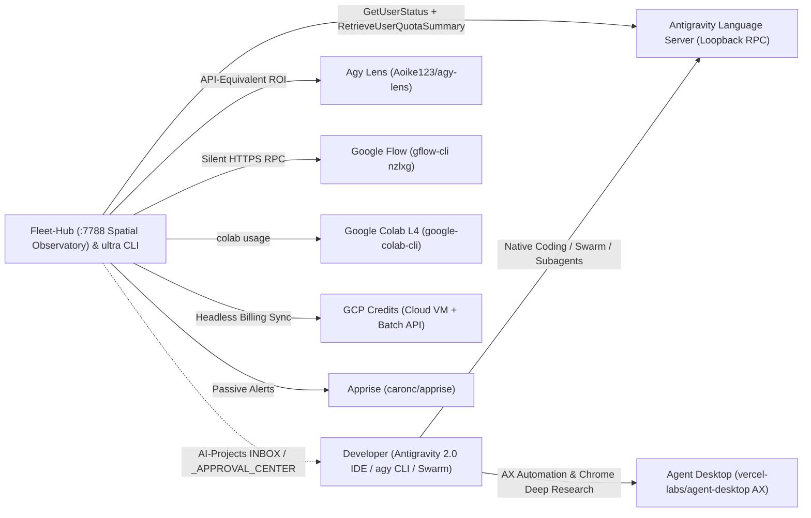

# Architecture (`Google AI Ultra Maximizer`)

Designed around Matt Pocock's **Deep Modules** (`codebase-design`) and **Software Factory** (`software-factory`) principles: keep custom Python small and deep, execute directly inside **native Antigravity 2.0**, delegate heavy capabilities to proven open-source **Wheels**, and verify every seam through public interfaces.

## System Topology (Pure Native Antigravity + Fleet-Hub)

## Role of Native `Antigravity 2.0` vs `:7788` Spatial Observatory

Because **Antigravity 2.0** natively handles multi-agent coding (`/swarm` + `invoke_subagent`), terminal execution, Plan Mode, and model switching across Gemini 4 and Claude 5.5, **no third-party proxy IDE or extra bot server is needed**:
1. **`Antigravity 2.0` (Primary Execution Surface)**: Multi-file engineering, Swarm workers, Plan Mode, and live model routing inside the native IDE & `agy` CLI.
2. **`Fleet-Hub (:7788)` (Cross-Pool Telemetry & Governance Plane)**:
   - Aggregates live balances across all 7 Google AI Ultra pools (`<15ms` cached per privacy mode, pre-warmed by `daemon.py`).
   - Renders dual-cycle concentric gauges (5h + 7d weekly) and runs zero-token `compute_routing_verdict()` so you immediately see when `Claude 5.5 (5h)` is 100% idle while `Gemini Weekly` is low.
   - Hosts operational tools: `ultra sync-gcp-credits` (Playwright grant table probe), `ultra wakeup`, `secrets.env` calibration, Privacy Mask screenshots, `Apprise` lock-screen alerts, and Yellow-Zone `--no-ff` merges to `main`.

## Deep Modules & Seams

| Module | Public Interface | Hidden Complexity |
|---|---|---|
| `fleet_hub/config.py` | `load_secrets()`, `detect_ai_hub()`, `wrap_cmd()`, `resolve_tool_bin()` | Dynamic workspace discovery, external SSD command wrapper detection, hot-reloaded `secrets.env`, privacy masking |
| `fleet_hub/agy_quota_probe.py` | `probe_antigravity_quotas(db, privacy)` | Daemon PID liveness check across `~/.gemini/*/daemon/hub_*.json`, proxy-bypassing loopback Connect-RPC, splitting Gemini Weekly vs Claude 5h buckets, Agy-Lens ROI summary |
| `fleet_hub/gflow_wire_probe.py` | CLI JSON output (`status`, `credits`, `email`) | `--password-store=basic` headless Chrome cookie extraction + cached pure-HTTPS `nzlxg` `batchexecute` RPC without opening browser windows |
| `fleet_hub/burn_advisor.py` | `build_burn_recommendations()`, `compute_routing_verdict()` | Cross-pool urgency math (5h rolling idle vs scarce weekly quota, month-end daily burn targets) and deterministic model routing verdict |
| `fleet_hub/bridges.py` | `collect_bridge_statuses(secrets)`, `probe_antigravity_native()`, `run_wakeup_trigger()` | Concurrent readiness probes (`antigravity`, `agy-lens`, `agent-desktop`, `apprise`), 5h wakeup, and GitHub Star check/action |
| `fleet_hub/notifier.py` | `send_notification()`, `notify_awaiting_approval()` | Multi-channel push delivery via `apprise` (`tgram://`, `bark://`, `discord://`, `slack://`) |
| `fleet_hub/worktree.py` | `create_isolated_worktree()`, `approve_task()`, `request_revision()` | Isolated Git worktrees, `.ai` symlink hygiene, Red-Zone `pre-push` hook guard, `--no-ff` merge with `[skip ci]` |

## Why We Compose Native Tools & Open-Source Wheels

1. **Native Execution (`Antigravity 2.0` > External Wrapper IDEs)**: Direct IDE, `agy` CLI, and `/swarm` execution connects straight to the local Language Server with zero third-party proxy risk.
2. **Real-Time Quota Telemetry (`hub_*.json` + `Agy Lens` + `antigravity-usage`)**: `agy_quota_probe.py` queries the local Antigravity Language Server (`GetUserStatus` + `RetrieveUserQuotaSummary`) directly for official per-model `remainingFraction` & `resetTime`, paired with `Aoike123/agy-lens` for 7-day API-equivalent ROI accounting.
3. **Computer Use Beyond the Terminal (`Agent Desktop`)**: `vercel-labs/agent-desktop` inspects macOS Accessibility (`AX`) trees as structured JSON (`@ref`), powering desktop automation and `gemini-web-research` Chrome Deep Research / AI Studio workflows.
4. **Push Notifications (`Apprise`)**: Passive alerts (e.g., Yellow-Zone approval ready or month-end quota flush) route through `caronc/apprise` URLs with one env line.
